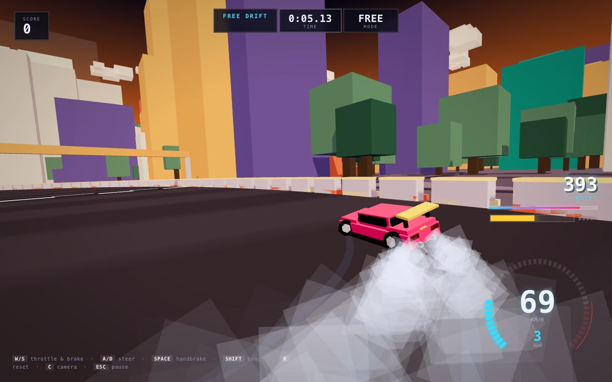
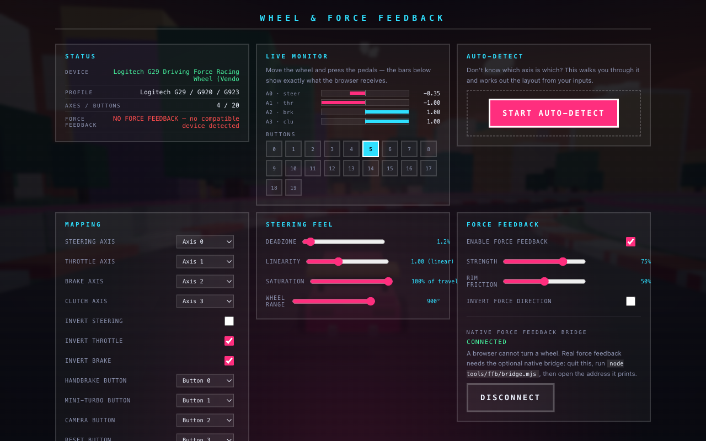

# DRIFTBLOCK

A 3D drift racing game with blocky minimalist graphics, running entirely in the
browser. No build step, no asset files — every circuit, sound and particle is
generated at runtime.



---

## Run it

**You must have [Node.js](https://nodejs.org) installed.** Then, from inside this
folder:

```bash
node tools/serve.mjs
```

That's the whole thing. It prints a `http://127.0.0.1:...` address and opens your
browser at it automatically. If port 8177 is busy it picks the next free one and
tells you which. Press `Ctrl+C` to stop.

> If you unzipped into a folder whose name has a space in it (e.g. `racing game`),
> put quotes around it when you `cd`:
> `cd "racing game"`

**No Node?** Any static server works — Python 3 ships on macOS and Linux:

```bash
python3 -m http.server 8177
```

then open <http://127.0.0.1:8177> yourself.

### Two things that will trip you up

- **Do not just double-click `index.html`.** The game is built from ES modules,
  and browsers refuse to load those over `file://` — you'll get a blank page and
  a console full of CORS errors. It has to come from a local web server, which is
  what the command above does.
- **The `vendor/` folder must be present.** It holds three.js, the only
  dependency. There is no `npm install` step, so if `vendor/` is missing the
  server will tell you so immediately rather than failing mysteriously later.

---

## Controls

| Action | Keyboard | Gamepad | Wheel | Touch |
|---|---|---|---|---|
| Throttle | `W` / `↑` | RT | throttle pedal | stick up |
| Brake / reverse | `S` / `↓` | LT | brake pedal | stick down |
| Steer | `A` `D` / `←` `→` | left stick | the wheel | stick left/right |
| Handbrake | `Space` | B / RB | bindable button | DRIFT button |
| Fire mini-turbo | `Shift` | A | bindable button | BOOST button |
| Reset to track | `R` | — | bindable button | — |
| Change camera | `C` | — | bindable button | — |
| Pause | `Esc` | — | — | — |

Once a wheel is connected it owns the driving controls outright; a wheel and a
keyboard fighting over the same axis is worse than either alone. Setup lives
under **WHEEL & FORCE FEEDBACK** on the title screen.

---

## How the drifting works

The car is not a rigid-body simulation. It is a purpose-built arcade drift model
(`src/physics.js`) tuned to feel good rather than to be physically exact. The
important part is *how* it slides:

1. **Velocity is split into the car's own forward and lateral axes.**
2. **Steering rotates the car, not the velocity.** Because the car rotates away
   from the direction it is actually travelling, forward speed is continuously
   converted into lateral speed. *That conversion is the slide* — it falls out
   of the maths rather than being faked.
3. **Lateral grip rotates the velocity vector back toward the car's nose**, at a
   rate set by grip. This step is deliberately energy-conserving (it only turns
   the velocity, never scales it). An earlier version simply deleted lateral
   velocity, which made every long slide and every donut bleed to a standstill.
4. **Sliding costs speed through an explicit scrub term** proportional to
   `sin(slip)`, so the trade-off between angle and speed stays under control.
5. **A self-aligning torque opposes the slip angle**, which is what makes a
   slide *catchable* instead of an instant spin.

### Grip blends, it doesn't switch

Grip slides smoothly from "planted" to "sliding" based on **either** an existing
slide **or** simply asking for too much yaw at speed under power. This matters:
with a hard on/off threshold the low-grip values could only be reached *after*
you were already sideways, which made the handbrake the only way to start a
drift. With the blend, a big handful of steering and throttle breaks traction on
its own, and the handbrake becomes a tool rather than a requirement.

### The reward loop

| | |
|---|---|
| **Slip angle** | Points scale with `speed × slip`, so fast, committed drifts pay far more than slow donuts. |
| **Multiplier** | +1 every 2 s of *unbroken* drift, up to ×10. |
| **Banking** | Straighten out for 0.45 s and the chain banks with a fanfare. |
| **Risk** | Hitting a wall burns the entire un-banked chain. |
| **Mini-turbo** | Drifting charges a boost over 3.2 s (three tiers). Releasing the drift fires it — up to about +35 km/h and a big FOV punch. |
| **Near miss** | Passing within 2.4 m of a barrier at speed pays a bonus. |

Drifting costs roughly 25–30 % of your corner speed versus a clean grip line,
so Time Trial and Drift Attack genuinely reward different driving.

---

## The engine

RPM is **not** a function of road speed. It is a state with its own dynamics,
because that is the whole difference between an engine that feels alive and one
that drones: the note has to answer your right foot, not the tarmac. Three
things move the revs —

- road speed through the current gear (the baseline),
- throttle, whenever the drivetrain is not locked up — pulling away, or the
  clutch slipping at low speed,
- **wheelspin**, so the engine screams while the rear tyres are lit.

Gear changes are events: power is cut briefly, the revs drop, and the exhaust
bangs. That rhythm is what stops acceleration feeling like one long elastic
pull. There is also a rev limiter stutter at the redline and exhaust crackle
when you lift off at revs. You can sit on the line and blip the throttle before
the countdown ends.

### Display sizing

The HUD is laid out in fixed pixels, so on a display whose CSS viewport is much
smaller than the panel — a scaled HiDPI mode, or browser zoom — it occupies a
disproportionate share of the screen: the speedometer alone goes from 13% of the
width at 1920 to 25% at 1024. A `--ui` scale factor is computed in `resize()`
and applied with CSS `zoom`, which scales a panel's size *and* its corner
offsets together so everything stays pinned where it belongs.

**GARAGE → DISPLAY** shows the live numbers (window, screen, devicePixelRatio,
render buffer, canvas size, current scale) and has a manual override if the
automatic value is not to your taste.

### Drivetrain

Each gear has a real ratio (`gearRatios`), and the force at the wheels is
engine torque **multiplied** by it. That is the whole reason a short gear pulls
and a tall one bogs: launching in 1st asks for ~9 m/s², in 4th about 4 — they
are not the same car any more.

The speed at which each gear reaches the redline is *derived* from its ratio
rather than being a hand-written table. Writing the two independently is how
they drift apart and leave a top gear that engages at a speed where it sits at
idle and cannot pull.

**Traction is a limit, not a number.** Ask for more force than the tyres can
take and they spin instead of gripping — which is what a burnout is, and what
happens if you launch hard in first. Brake and throttle together at a standstill
holds the car and lights the rears up while the engine screams.

**Reverse needs a deliberate hold.** Braking to a stop never puts you in
reverse; the brake has to be held for 1.2 s while stationary. Pressing the brake
pedal should never make you go backwards.

### Sense of speed

The lens does most of the work. Field of view opens from 68° to about 102° across
the speed range, the camera pulls back and sinks toward the road, and a constant
high-speed tremor keeps the car from feeling like it is on rails. The road also
carries lane dashes and higher-contrast shade bands, because a flat untextured
surface gives the eye nothing to measure speed against.

---

## Racing wheels and force feedback

Plug a wheel in and it works — presets exist for Logitech, Thrustmaster and
Fanatec, and anything unrecognised is detected by shape.

Because no preset can cover every wheel, **WHEEL & FORCE FEEDBACK** on the title
screen has a live monitor showing exactly what the browser is receiving, plus an
auto-detect pass. Auto-detect asks you to hold the wheel fully left, then fully
right. That second step matters: the numbers alone cannot tell left from right,
so the wizard takes you at your word and derives the direction from which way
you turned. Both hardware polarities end up calibrated identically.

### Real force feedback

A browser cannot turn a steering wheel — the Gamepad API is input-only, and
`vibrationActuator` just rumbles a pad. Actual torque needs a native process on
the USB HID device:

```bash
cd tools/ffb && npm install
node tools/ffb/bridge.mjs          # serves the game + force feedback
node tools/ffb/bridge.mjs --probe  # just check the wheel is visible
```

The wheel then pushes back with a tyre model, not a rumble: **aligning torque**
that peaks around 32° of slip and falls away as grip goes (your warning that the
car is about to step out), **rim friction** that drops sharply once the rear
lets go, and an impact **kick**. See [tools/ffb/README.md](tools/ffb/README.md).

Entirely optional — without it the game plays the same, it just does not push
back. Note the G29's mode switch must be in **PS3** position for the native path,
and Logitech G HUB must be closed so it is not holding the device.



---

## Tracks

All four circuits are generated from **radial harmonics** — `r(θ) = R₀ + Σ Aᵢ·sin(kᵢθ + φᵢ)`
— which mathematically guarantees a closed, non-self-intersecting loop. Corner
tightness is controlled by `A·k²`, so each track's character comes from its
harmonic set.

| Track | Character |
|---|---|
| **Sunset Strip** | Long flowing sweepers. The place to learn. |
| **Harbor Hairpins** | Tight and technical; genuinely sub-15 m corners. |
| **Neon Docks** | Long, fast and awkward under a violet sky. |
| **The Bowl** | Not a circuit — a 74 m wide walled arena for freestyle. |

---

## Project layout

```
index.html            markup + HUD
src/
  main.js             renderer, menus, save data, fixed-step loop
  physics.js          the drift model (pure maths, no renderer)
  car.js              blocky chassis mesh + visual state
  track.js            procedural circuits, scenery, palettes, lighting
  camera.js           chase rig (follows velocity, wall-aware)
  effects.js          smoke, skid marks, sparks, speed lines
  audio.js            fully synthesised engine/tyres/impacts/UI
  hud.js              tachometer canvas + drift readouts
  game.js             scoring, combo chains, collisions, run modes
  input.js            keyboard / gamepad / wheel / touch
  wheel.js            wheel detection, calibration, learning wizard
  ffb.js              force model + rumble / native-bridge backends
  wheelui.js          the wheel setup screen
tools/
  serve.mjs           no-cache dev server
  static-server.mjs   shared static handler
  tune.mjs            headless physics tuning harness
  trackcheck.mjs      track geometry validation + AI lap test
  fuzz.mjs            randomised soak test for NaNs and blow-ups
  ffbcheck.mjs        wheel mapping + force-feedback direction tests
  revcheck.mjs        engine / gearbox behaviour tests
  ffb/
    bridge.mjs        native wheel + force feedback bridge
    ws-server.mjs     dependency-free WebSocket server
```

### Development tools

The three tools under `tools/` run headlessly in Node and were used to build the
game. They are the fastest way to change the handling:

```bash
node tools/tune.mjs            # 0-100, drift envelope, donuts, recovery, boost
node tools/trackcheck.mjs      # geometry + "can an AI actually lap this?"
node tools/fuzz.mjs 240 1,7,99 # 240 s per track/mode/seed, hunts NaNs
node tools/ffbcheck.mjs        # wheel axes, pedals, wizard, FFB direction
node tools/revcheck.mjs        # engine response, gearbox, wheelspin, shifts
```

`tune.mjs` prints a drift envelope — the steady-state slip angle for every
combination of handbrake, throttle and steering. If you change a handling
constant, run it and read the table rather than guessing in the browser.

`ffbcheck.mjs` is worth knowing about if you touch the wheel code: it drives the
real `Input.update()` merge with stubbed devices, because the wheel's steering
sign and the keyboard's are flipped in different places and it is very easy to
flip one twice.

---

## Audio

Everything is synthesised with the Web Audio API — there are no sound files.
The engine is three detuned sawtooths plus a sub-octave square and band-passed
noise, driven by a six-speed gearbox model with shift blips. Tyre squeal is
band-passed noise with a resonant whistle layer on top, and the mini-turbo is a
swept saw plus a noise whoosh.
